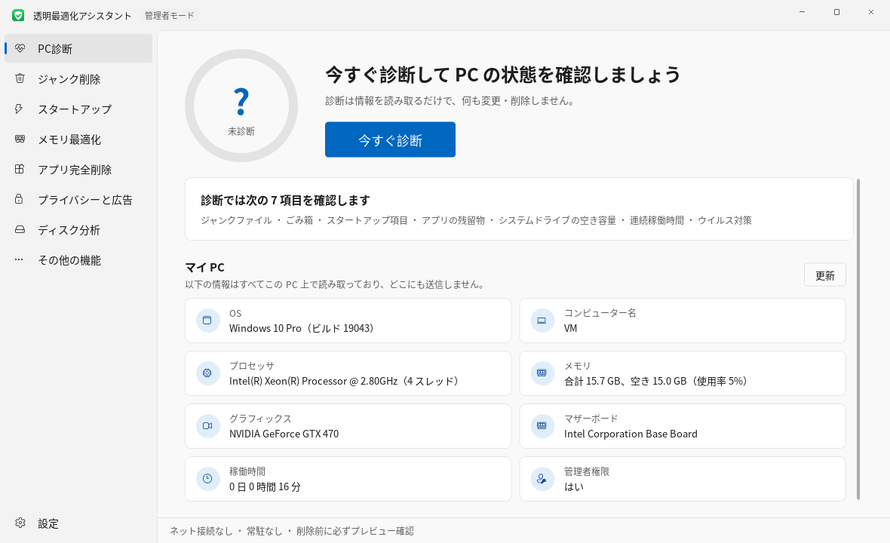
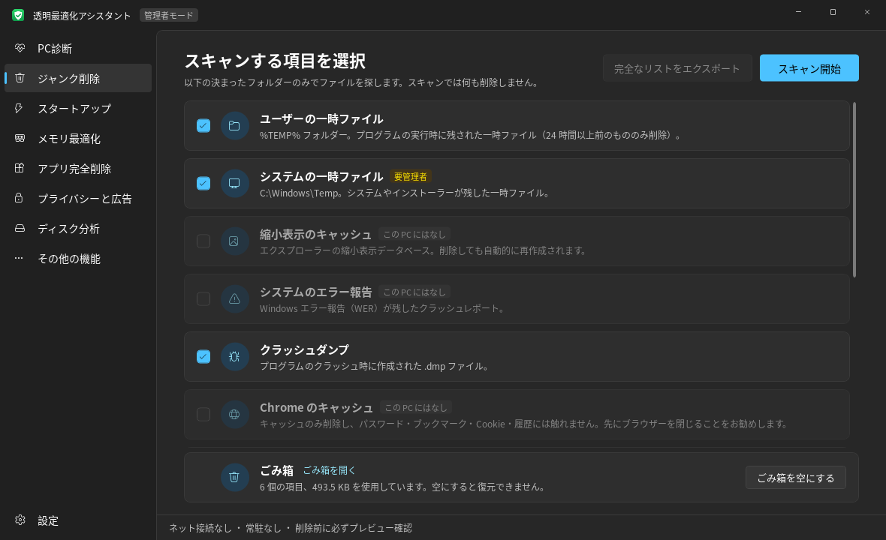

# 透明最適化アシスタント

[English](README.md) | [简体中文](README.zh-CN.md) | [繁體中文](README.zh-TW.md) | **日本語**

自分で読んで理解でき、中身を確認できる Windows PC 最適化ツールです。ネットに接続せず、常駐せず、広告もありません。削除はすべて先に明細を表示し、確認してから実行します。

画面は簡体字中国語・繁体字中国語・日本語・英語に対応しています。初回起動時はシステムの言語に合わせ、その後は左下の「設定」で切り替えられ、すぐに反映されます。

画面は Windows 11 のシンプルなスタイルに合わせ、ライトとダークの 2 つのテーマがあります。既定ではシステムの設定に従い、左下の「設定」でも切り替えられます。ボタンの色はシステムの「アクセントカラー」に従います。

| ライト | ダーク |
|---|---|
|  |  |

## すぐに使う

1. [Releases](../../releases) から最新の zip をダウンロードし、展開して `PcOptimizer.exe` をダブルクリックします。zip に含まれる `SHA256.txt` でファイルが破損していないか確認できます。
2. インストールは一切不要です。.NET Framework 4.8 で動作し、Windows 10（1903 以降）と Windows 11 には標準で入っています。
3. 既定では通常の権限で実行されます。システムの一時ファイルや更新キャッシュの削除、「すべてのユーザー」のスタートアップ項目の変更には管理者権限が必要です。下部バーの「管理者として再起動」を押してください。

> 初回実行時に Windows SmartScreen が「不明な発行元」と表示することがあります。この exe にはデジタル署名がないためです（署名用の証明書は有料です）。「詳細情報 → 実行」を押せば起動できます。心配な場合は、下記の手順でソースコードから自分でビルドできます。

## 機能

| ページ | できること | PC を変更するか |
|---|---|---|
| PC診断 | 不要ファイル、ごみ箱、スタートアップ項目の数、アプリの残留物、システムドライブの空き容量、連続稼働時間、ウイルス対策の状態をチェックし、スコアを表示します。下の「マイ PC」には、システムのバージョン、CPU、メモリ、グラフィックス、マザーボード、起動からの経過時間を表示します | 読み取りのみです。「ワンクリックでジャンク削除」は、削除する内容を先にダイアログで一覧表示します |
| ジャンク削除 | 一時ファイル、サムネイルキャッシュ、エラーレポート、クラッシュダンプ、Chrome/Edge のキャッシュ、更新キャッシュ、ごみ箱をスキャンします。さらに Windows 更新の残留物（古いシステム コンポーネント WinSxS）もクリーンアップできます。「このツール自身のファイル」で、このツールの操作ログとバックアップを確認・削除できます | スキャンは読み取りのみです。削除前にファイルを 1 つずつ確認したり一覧をエクスポートしたりでき、さらに 2 回目の確認があります。更新の残留物は Windows 標準の DISM に任せ、/ResetBase は使わないため、インストール済みの更新は引き続きアンインストールできます。ログは内容をプレビューしてからチェックして削除でき、削除したファイルはごみ箱に移ります |
| スタートアップ | レジストリの Run キーとスタートアップフォルダーにあるスタートアップ項目を一覧表示し、スイッチで無効/有効を切り替えます。「プログラムが存在しません」となった無効な項目を表示します | 通常の項目はスイッチを切り替えるだけです。無効な項目は削除でき、削除前にバックアップを取ります |
| メモリ最適化 | あなた自身が実行したアプリを一覧表示し（同じプログラムの複数プロセスは 1 項目にまとめます）、使用量順に並べて「バックグラウンド」「自動起動」を表示します。アプリの終了や自動起動のオフがその場でできます | システムプロセス、ウイルス対策ソフト、Windows フォルダー内のプログラムは表示しません。終了時はまず通常の方法で閉じ、3 秒たっても終わらない場合のみ強制終了します。「ワンクリックメモリ解放」は行いません |
| アプリ完全削除 | インストール済みのアプリを一覧表示し、アプリ付属のアンインストーラーを呼び出します。アンインストール後に残ったフォルダー、レジストリ、スタートアップ項目を検索します。アンインストーラーが存在しない無効な登録も表示します。アンインストールしたばかりのアプリは上部の固定高さのバーにまとめられ、個別に外すことも、すべて閉じることもできます | アンインストールはアプリ自身のアンインストーラーが行います。残留物は 1 項目ずつ確認し、フォルダーはごみ箱へ移動、レジストリは先にバックアップします |
| プライバシーと広告 | Windows に組み込まれた広告、おすすめ、データ収集をオフにします。スタート メニューのおすすめ、ロック画面の広告、おすすめアプリの自動インストール、広告識別子、検索の Bing 結果、Copilot、リコール、オプションの診断データなど全 19 項目。「おすすめを一括オフ」は「オフ推奨」の項目だけを変更します | 変更するのは Windows 自身の設定やグループ ポリシーに対応するレジストリ値だけで、サービスの停止、hosts の変更、システム ファイルの変更はしません。項目ごとに既定に戻せるほか「すべて既定に戻す」もあります。説明にマウスを合わせると変更する値が表示されます |
| その他のツール · アプリの更新 | winget で新しいバージョンがあるアプリを探し、選んでまとめて更新します。結果や失敗の理由は各アプリの右側に表示します | 検索、ダウンロード、インストールはすべて Windows 付属の winget が行います（winget がネットに接続します）。自動インストールで、更新前に一覧で確認します。結果はログに記録します |
| その他のツール · プリインストール アプリの削除 | Windows や PC メーカーがプリインストールした Microsoft Store アプリ（ゲーム、宣伝アプリ、使わない Microsoft アプリ）を「削除をおすすめ」と「必要に応じて」に分けて表示し、選んで削除します。削除したアプリはワンクリックで Microsoft Store から再インストールできます | Windows 付属の Get-AppxPackage / Remove-AppxPackage を使い、現在のユーザーからだけ削除します。Microsoft Store、セキュリティ センター、ランタイム、画像コーデックなどのシステム コンポーネントは表示しません。削除前に一覧で確認します |
| その他の機能 · ウイルス対策 | 保護の状態（リアルタイム保護、ウイルス定義の日付、他社製ウイルス対策ソフト）を確認します。クイックスキャン、フルスキャン、指定したファイル/フォルダーのスキャン（ドラッグ＆ドロップ可）、ウイルス定義の更新、Defender の検出履歴の確認ができます | 独自のウイルス定義は持たず、すべて Windows 標準の Microsoft Defender（MpCmdRun.exe）に任せます。脅威が見つかった場合は Defender が既定の設定で処理します（通常は隔離）。誤検出は Windows セキュリティで復元できます。ウイルス定義の更新時に通信するのは Defender で、このツールではありません |
| その他の機能 · 重複ファイル削除 | 1 つ以上のフォルダーを選び、内容がまったく同じファイルを見つけます。各グループでは既定で最も古いファイルを残します | MD5 で判定します（サイズが同じファイルだけ MD5 を計算します）。各グループで必ず 1 つは残します。削除前に MD5 を計算し直し、変更されていたものはスキップします。削除したファイルはごみ箱へ移動します |
| その他の機能 · ネット接続管理 | どのアプリが通信中で、どのアドレスに接続しているかを確認できます。一定時間内に通信したアプリをすべて記録することもできます（管理者として実行すると精密モードになり、取りこぼしがありません）。待ち受け中のポートと、ほかの PC から接続できるかも確認できます（リモート デスクトップ、ファイル共有、データベースなど注意が必要なポートに印を付けます）。特定のアプリの通信を禁止したり、アップロード速度を制限したりできます | 通信の禁止 = Windows ファイアウォールのルール（名前は「透明优化助手-禁止联网」で始まります）。アップロードの速度制限 = Windows 標準の QoS ポリシー。ドライバーをインストールしないため、ダウンロード速度は制限できません |
| その他の機能 · 右クリックメニュー管理 | アプリが右クリックメニューに追加した項目を一覧表示し、非表示/復元できます | 非表示にするだけで削除はしません。メニューコマンドには LegacyDisable を追加し、シェル拡張は Shell Extensions\Blocked に書き込みます |
| その他の機能 · ファイル完全削除 | ファイルやフォルダーをドラッグ＆ドロップすると完全に削除し、復元ソフトで取り戻せないようにします | ランダムなデータで上書き（1 回または 3 回、毎回ディスクへ強制書き込み）→ 0 バイトに切り詰め → ランダムな名前に変更 → 削除。システム/アプリのフォルダー、AppData、ドライブのルート、ユーザーフォルダーそのものは対象外です。実行前にダイアログで確認します。SSD では物理的な消去を保証できません |
| ディスク分析 | どのフォルダーやファイルが最も容量を使っているかを確認でき、階層を順にたどれます。よくある大きなファイルやフォルダー（休止状態ファイル、ページ ファイル、システムの復元ポイント、仮想マシンのディスク、ダウンロードしたインストーラーなど）には、何なのか・削除してよいかの説明が付きます。「ドライブの健康状態」タブでは、各ドライブの健康状態、電源投入時間、温度、摩耗度、読み書きエラー、各パーティションのフォーマットと空き容量を表示します | 読み取りのみ。「通常は削除して大丈夫」と表示されたファイルだけ、ごみ箱へ移動または完全に削除（確認あり）できます。システム ファイルは削除できません。健康状態の情報は Windows 標準のストレージ管理インターフェイス（Get-PhysicalDisk）から取得するため、一部の USB ケースや RAID では読み取れません |

## 安全のための設計

- **ネットに接続しない**：ソースコードにはネットワーク関連のコードが一切ありません。`Http`、`Socket`、`WebClient` を検索すればご自身で確認できます。「アプリの更新」とウイルス定義の更新は、それぞれ Windows 付属の winget と Defender に任せています。ネットに接続するのはそちらで、このツールではありません。
- **常駐しない**：サービスのインストール、スタートアップへの登録、タスク スケジューラへの登録は行いません。ウィンドウを閉じるとプロセスも終了します。
- **ホワイトリスト方式の削除**：決まったフォルダーの中だけでファイルを探し、ドライブ全体の「スマート検出」は行いません。一時ファイルは 24 時間以上前のものだけを削除します。
- **削除前の再確認**：各ファイルは削除の直前にもう一度チェックし、ホワイトリストのフォルダー内にあること、スキャン後に変更されていないこと、リンクでないことを確認します。使用中のファイルはそのままスキップします。
- **リンクをたどらない**：シンボリックリンクやディレクトリ ジャンクションはスキップし、リンクをたどって別の場所を削除してしまうことを防ぎます。
- **元に戻せるスタートアップのスイッチ**：Windows 自身の `StartupApproved` の仕組みを使っており、タスク マネージャーの「スタートアップ」タブと同じスイッチなので、タスク マネージャーからも元に戻せます。削除できるのは、参照先のプログラムがもう存在しない無効な項目だけです。
- **控えめな残留物の判定**：名前が完全に一致する場所だけを対象にします。具体的には、元のインストールフォルダー、よく使われるデータフォルダー内でアプリ名（または「発行元\アプリ名」）と同じ名前のフォルダー、レジストリの `Software` 以下の同名のキー、削除済みのプログラムを指すスタートアップ項目です。ほかのインストール済みアプリが使っている場所、システムフォルダー、ユーザーフォルダーそのもの、一般的すぎる名前（Update、Common など）はすべて除外します。
- **削除は元に戻せる**：残留フォルダーはごみ箱へ移動し、ごみ箱に入れられない場合は Windows が先にダイアログで確認します。レジストリは削除前に `.reg` ファイルとしてエクスポートして `logs\backup` に保存するので、ダブルクリックで復元できます。
- **操作ログ**：削除したファイルとスタートアップ項目の変更は、すべて `logs\yyyy-MM-dd.log` に記録します。プログラムのフォルダーに書き込めない場合は、`%LOCALAPPDATA%\PcOptimizer\logs` に記録します。
- 使用している Windows API はすべて `Core/NativeMethods.cs` にまとめてあり、確認しやすくしています。

## 自分でビルドする

[.NET SDK](https://dotnet.microsoft.com/download)（8.0 以降）が必要です。SDK はビルド時にだけ使い、exe の実行には必要ありません。

```
build.bat をダブルクリック
または：cd src\PcOptimizer && dotnet build -c Release
```

生成されるファイルは `src\PcOptimizer\bin\Release\net48\PcOptimizer.exe` です。

コアロジックのテストを実行するには：

```
cd tests\CoreTests && dotnet run
```

GitHub にプッシュすると、`.github/workflows/build.yml` が Windows 上で自動的にテストとビルドを行います。`v` で始まるタグ（例：`v1.6.0`）をプッシュすると自動で Release が作成され、zip と SHA256 が添付されます。

## テスト状況

- コア ロジックには 45 個の単体テストがあり、「プレビューに表示されたファイルだけを削除する」「リンクをたどらない」「スキャン後に変更されたファイルはスキップする」、アンインストール後の残留物の照合、`.reg` バックアップの形式などを確認しています。4 言語の翻訳表がそろっていることもチェックしています。実行方法は上の「自分でビルドする」を参照してください。
- 作者は自分の Windows PC で日常的に使っています。
- アプリのアンインストーラー、DISM、ドライブの健康状態のデータなどは実際のシステム環境に依存するため、PC によって動作が異なる場合があります。問題があれば Issue でお知らせください。

ご自分の PC で初めて使うときは、まずスキャンだけを行い、「明細を表示」や「完全なリストをエクスポート」で結果に問題がないことを確認してから削除を実行することをおすすめします。

## 多言語対応

ソースコード内の画面の文字列はすべて簡体字中国語で直接書かれており、ほかの言語は「簡体字の原文 → 訳文」の対応表を引いて表示します。

- 翻訳表は `src/PcOptimizer/Lang/`（`zh-TW.lang`、`ja.lang`、`en.lang`）にあり、ビルド時に exe に埋め込まれます。各項目は 2 行で、1 行目が簡体字の原文、2 行目の `=> ` の後ろが訳文です。
- コードでは `L.T("...")`、`L.F("... {0} ...", n)` を使います（引用符の中には簡体字中国語の原文を書きます）。XAML 内の文字列はコントロールの読み込み時に `UiText.cs` が自動で置き換えるので、XAML を変更する必要はありません。
- 訳文が見つからない文字列は簡体字の原文のまま表示されます。画面の文字列を追加・変更したら、3 つの翻訳表に対応する項目を忘れずに追加してください（3 つの表の項目がそろっているかは単体テストでチェックされます）。
- 選択した言語は exe と同じフォルダーの `settings.ini` に保存されます。

## 免責事項

このツールはファイルの削除、レジストリやシステム設定の変更を行います。各操作は事前にプレビューして確認を求め、できるだけ元に戻せるようにしていますが（ごみ箱、`.reg` バックアップ）、ソフトウェアの不具合や誤操作によってデータの損失やシステムの問題が起きる可能性はあります。**使用前に重要なデータは必ずご自身でバックアップしてください。本ツールの使用によって生じたいかなる結果も、すべて使用者ご自身の責任となります。** ファイル完全削除を行ったデータは復元できませんので、特にご注意ください。

本ツールは、いかなるウイルス対策ソフトやシステム最適化ソフトのメーカーとも関係ありません。「ウイルス対策」は Windows 標準の Microsoft Defender を呼び出しているだけです。

## ライセンス

[MIT](LICENSE)。個人プロジェクトのため、Issue への迅速な返信は保証できません。

## コード構成

```
src/PcOptimizer/
  Core/               ビジネスロジック（画面とは独立）
    Cleaner.cs          クリーンアップ対象の定義、スキャン、削除前の再確認、削除
    MemoryManager.cs    実行中のアプリ、プロセスの終了
    Dedup.cs            重複ファイルの検出（MD5）
    NetControl.cs       接続テーブル、ファイアウォール ルール、QoS 速度制限
    Ports.cs            待ち受けポートの整理とよく使われるポートの説明
    NetRecorder.cs      通信したアプリの継続記録
    NetTrace.cs         精密モード：ETW で通信イベントを受信
    ContextMenus.cs     右クリック メニュー項目の読み取り、非表示、復元
    Shredder.cs         ファイルの完全削除
    Defender.cs         ウイルス対策（Microsoft Defender を呼び出す）
    Privacy.cs          プライバシーと広告のスイッチ
    StoreApps.cs        プリインストール アプリ（ストア アプリ）の一覧と削除
    PowerShell.cs       Windows 標準の PowerShell を呼び出す
    Winget.cs           アプリの更新（winget を呼び出して結果を解析）
    WindowsResidue.cs   Windows 更新の残り（WinSxS）
    Loc.cs              多言語の訳文検索（L.T / L.F）
    AppSettings.cs      設定ファイル settings.ini（言語、テーマ）
    StartupManager.cs   スタートアップ項目の読み取りと切り替え
    DiskUsage.cs        ディスク使用量の集計
    DiskHealth.cs       ドライブの健康状態、使用記録、パーティション情報
    SpaceHints.cs       よくある大きなファイルとフォルダーの説明（削除してよいか）
    LogFiles.cs         このツールのログとバックアップの一覧、プレビュー
    SysInfo.cs          システム情報
    HealthCheck.cs      PC 診断のスコア
    Programs.cs         インストール済みアプリ、アンインストール コマンド、無効な項目
    Residue.cs          アンインストール後の残留物の検出と削除
    RegBackup.cs        レジストリ削除前の .reg バックアップ
    ShellLink.cs        ショートカットのリンク先プログラムの読み取り
    RecycleBin.cs       ごみ箱
    NativeMethods.cs    すべての Windows API 宣言
    FsUtil.cs / OpLog.cs
  Assets/             アプリ アイコン app.ico、タイトル バーのマーク mark.png、それらを生成する make-logo.py
  Pages/              各ページ。Pages/Tools/ は「その他の機能」のツール
  Themes/Styles.xaml  ライト/ダークの配色、ボタン、スイッチ、スクロールバーなどのスタイル
  MainWindow.xaml     メイン ウィンドウ（タイトル バー + 左側ナビゲーション）
  AdminDrop.cs        管理者モードでエクスプローラーからドラッグされたファイルを受け取る
  LogWindow.cs        このツールのログの表示と削除ウィンドウ
  UiText.cs           XAML に書かれた中国語を現在の言語に置き換える
  Theme.cs            ライト/ダーク テーマとシステムのアクセント カラー
  Lang/               繁体字中国語、日本語、英語の翻訳表
tests/CoreTests/      コアロジックのテスト
```

## 更新履歴

- v2.5.1：「継続記録」の説明と開始/停止ボタンを上部に固定し、一覧をスクロールしても動かないようにしました。記録中にプログラムを終了するときは確認を表示します。
- v2.5：「継続記録」に精密モードを追加しました。管理者として実行すると、Windows のイベント トレーシング（ETW、リソース モニターも使っている仕組み）で通信を 1 回ずつ受け取るため、ごく短い接続や DNS 問い合わせなどの UDP 通信も記録できます。通常の権限では引き続き 1 秒ごとに確認します。
- v2.4：「ネット接続管理」に「継続記録」を追加しました。ページを開いている間、1 秒ごとに接続テーブルを確認し、その間に通信したアプリをすべて一覧にします。ときどき短時間だけ通信するアプリも見逃しにくくなりました。
- v2.3.5：ログが非常に大きい場合（大規模なクリーンアップ 1 回で数百 MB になることがあります）、ログの表示では末尾だけを読み込み、ファイル全体をメモリに読み込まないようにしました。
- v2.3.4：「プライバシーと広告」で、Windows 自身の設定ですでに非表示にしている Copilot とタスク バーのニュース/天気が、オンではなく「非表示」と表示されるようにしました。
- v2.3.3：「システム情報」ページをなくし、「マイ PC」の情報を「PC診断」ページの下に移しました。ディスクの状況は「ディスク分析」で確認できます。
- v2.3.2：「ディスク分析」の 2 つの一覧の間に、ドラッグして幅を調整できる仕切りを追加しました。大きなファイルの一覧に右クリック メニュー（ごみ箱へ移動、完全に削除（確認あり）、ファイルの場所を開く、プロパティ）を追加しました。
- v2.3.1：「管理者として再起動」を押した後、元のページに戻るようにしました。「ドライブの健康状態」の説明を短くしました。
- v2.3：「ディスク分析」に「ドライブの健康状態」を追加し、各ドライブの健康状態、電源投入時間、温度、摩耗度、読み書きエラーと、パーティションのフォーマット・空き容量を表示するようにしました。よくある大きなファイルやフォルダーに、何なのか・削除してよいかの説明が付き、削除してよいものはそのままごみ箱に移せます。このツール自身のログの確認と削除（先に内容をプレビュー）を追加しました。言語メニューで英語を先頭にしました。スキャン中にページを切り替えるとまれに強制終了する問題を修正しました。
- v2.2.4：左上のタイトル バーのアイコンを、プログラムのアイコンと同じ緑地に白い盾のデザインに統一しました。
- v2.2.3：Windows.old の削除機能を取り除きました。削除の途中で電源が切れた場合に、その後の「以前のバージョンに戻す」が問題なく動くことを 100% 保証できないためです。Windows.old は戻せる期限が過ぎると 通常 Windows が自動的に削除します。
- v2.2.2：Windows.old の説明と削除の確認に「新しいバージョンで問題がなく、戻す予定がないときに削除」を追加し、Windows で戻せるのは通常更新後 10 日以内であることも記載しました。
- v2.2.1：システム コンポーネントのクリーンアップ前の確認メッセージを、インストール済みの更新に影響があるように読めない表現に改めました。
- v2.2：「ネット接続管理」に「待ち受け中のポート」を追加。ほかの PC からの接続を待っているアプリを確認でき、注意が必要なポートに印を付けます。「ジャンク削除」に「Windows 更新の残留物」を追加し、Windows.old の削除と古いシステム コンポーネント（WinSxS）のクリーンアップができるようにしました。
- v2.1：「アプリの更新」を追加（「その他のツール」内）。Windows 付属の winget で複数のアプリをまとめて更新できます。
- v2.0：「プリインストール アプリの削除」を追加（「その他のツール」内。「アプリ完全削除」からも開けます）。Windows やメーカーがプリインストールしたゲームや宣伝アプリを削除でき、削除したアプリは Microsoft Store から再インストールできます。
- v1.9：「プライバシーと広告」ページを追加。Windows に組み込まれた広告、おすすめ、データ収集をまとめてオフにでき、いつでも既定に戻せます。PC チェックにプライバシーの項目を追加しました。
- v1.8.1：ごみ箱の横に「ごみ箱を開く」リンクを追加。検索ボックスと絞り込みの間に余白を追加。句読点を整理しました（見出しは読点なし、説明文は句点で終える）。
- v1.8：言語の切り替えが再起動なしですぐに反映されるようになりました。「アプリ削除」を「アプリ完全削除」に改名し、アンインストール後に残留物も探すことを分かりやすくしました。
- v1.7.1：下部バーのテーマ・言語・操作ログ・バージョン情報を左下の「設定」メニューにまとめました。
- v1.7：画面を Windows 11 風に変更しました（左側のナビゲーション、淡いグレーの配色、システムのアクセントカラー）。ライト/ダークテーマに対応しました（既定はシステムに従う、手動でも切り替え可能、すぐに反映）。スクロールバー、ドロップダウン、メニュー、ツールチップも細い角丸の新しいデザインにしました。
- v1.6：画面が繁体字中国語・日本語・英語に対応しました。オープンソース化に必要な LICENSE、.gitignore、免責事項、GitHub の自動ビルド設定を追加しました。
- v1.5.1：プログラムのアイコン（緑の角丸の背景 + 白い盾 + チェックマーク）を追加しました。exe、タスクバー、ウィンドウのタイトルバーに表示されます。
- v1.5：「ウイルス対策」を追加しました（Windows 標準の Microsoft Defender と連携）。PC診断にウイルス対策のチェックを追加しました。ファイル完全削除の確認をダイアログ方式に変更し、文字の入力が不要になりました。
- v1.4.1：「ファイル完全削除」にファイルをドロップできない問題（カーソルが🚫になる）を修正しました。原因は、このツールが管理者として実行されているため、通常の権限のエクスプローラーから管理者のウィンドウへのドラッグを Windows が許可しないことでした。管理者モードでは Windows 標準の旧来のドラッグ＆ドロップ メッセージで受け取るように変更し、そのメッセージだけを通過させるようにしました。
- v1.4：「ファイル完全削除」を追加しました。「ジャンク削除」を初めて開いたときに動作が止まる問題を修正しました（原因は UI スレッドでごみ箱の集計を行っていたことで、ごみ箱の中身が多いと数秒かかっていました。現在はバックグラウンドで処理します）。
- v1.3：「その他の機能」タブを追加し、あまり使わない 3 つのツール（重複ファイル削除、ネット接続管理、右クリックメニュー管理）をまとめました。
- v1.2：「メモリ最適化」ページを追加しました。本当に役立つことだけを行います：使っていない常駐アプリを終了し、その自動起動をオフにします。「ワンクリックメモリ解放」（ワーキングセットの解放）は行いません。これはメモリの内容をディスクのページングファイルに移すだけで、使うときにまた読み戻すため、かえって動作が重くなります。
- v1.1.1：アンインストールページの「アンインストールしたばかりのアプリ」を固定高さのタグ状のバーに変更し、いくつアンインストールしても下のアプリ一覧が押し出されないようにしました。
- v1.1：アプリのアンインストールと残留物の削除を追加しました。スタートアップのページで「プログラムが存在しません」の項目を表示し、削除できるようにしました。

## 今後追加できそうなもの

タスク スケジューラやサービスに登録された自動起動項目、デジタル署名。
