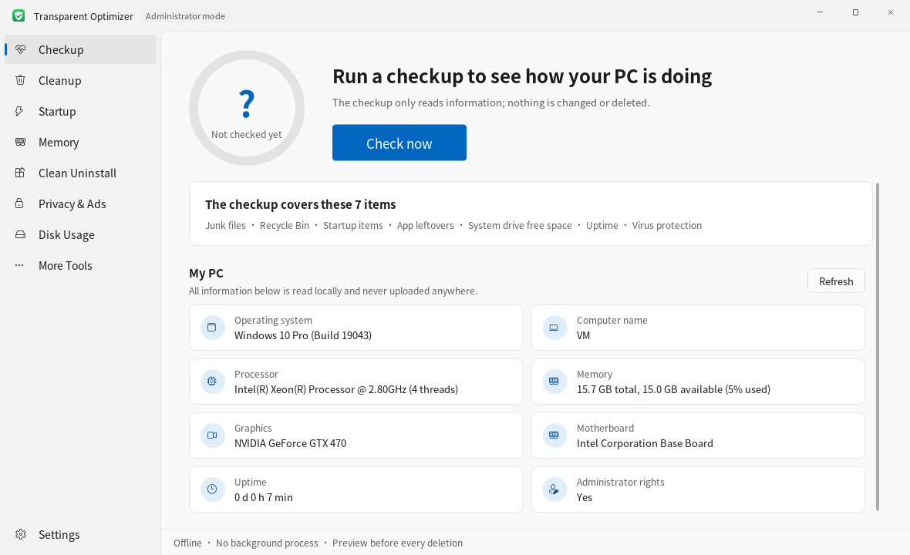
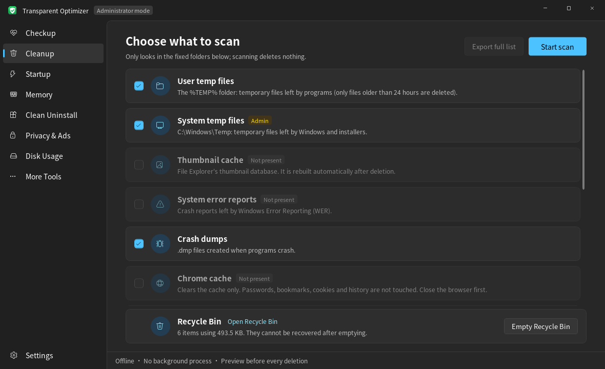

# Transparent Optimizer

**English** | [简体中文](README.zh-CN.md) | [繁體中文](README.zh-TW.md) | [日本語](README.ja.md)

A Windows PC optimizer you can actually read and audit: no network access, nothing left running in the background, no ads. Every deletion is listed in detail first and only carried out after you confirm.

The interface is available in Simplified Chinese, Traditional Chinese, Japanese and English. On first launch it follows the system language; after that you can switch it under Settings in the bottom-left corner, and the change takes effect immediately.

The look follows Windows 11: a clean, light-grey layout with light and dark themes. By default it follows your system setting; you can also switch it under Settings in the bottom-left corner. Buttons use your system accent color.

| Light | Dark |
|---|---|
|  |  |

## Getting started

1. Download the latest zip from [Releases](../../releases), extract it and double-click `PcOptimizer.exe`. You can use the `SHA256.txt` in the zip to verify the files are intact.
2. Nothing needs to be installed. The app is built on .NET Framework 4.8, which ships with Windows 10 (1903 and later) and Windows 11.
3. By default it runs with standard permissions. Cleaning system temp files and update caches, and changing "All users" startup items, require administrator rights — just click "Restart as administrator" in the bottom bar.

> On first run, Windows SmartScreen may warn about an "Unknown publisher", because the exe is not digitally signed (signing certificates cost money). Click "More info → Run anyway". If you'd rather not, you can build it yourself from source using the steps below.

## Features

| Page | What it does | Does it change your PC? |
|---|---|---|
| Checkup | Checks junk files, the Recycle Bin, number of startup items, app leftovers, free space on the system drive, uptime and virus protection status, and gives a score; "My PC" below shows OS version, CPU, memory, graphics card, motherboard and uptime | Read-only. "One-click cleanup" first shows a dialog listing what will be deleted |
| Cleanup | Scans temp files, thumbnail cache, error reports, crash dumps, Chrome/Edge caches, update caches and the Recycle Bin; plus Windows update leftovers: old system components (WinSxS); "This tool's own files" lets you view and clean up this tool's operation logs and backups | Scanning is read-only; before deleting you can view every file, export the list, and confirm a second time; update leftovers are handled by Windows' own DISM, without /ResetBase, so installed updates can still be uninstalled; logs are previewed before you tick and delete them, and deleted files go to the Recycle Bin |
| Startup | Lists startup items from the registry Run keys and Startup folders, with a switch to disable or enable each; flags broken items marked "Program missing" | Normal items only get their switch toggled; broken items can be deleted, and are backed up first |
| Memory | Lists apps you started yourself (multiple processes of the same program merged into one entry), sorted by usage, marked "Background" and "Runs at startup"; you can end an app or turn off its autostart directly | Does not list system processes, antivirus software or programs in the Windows folder; ending an app first closes it normally and only force-ends it if it hasn't exited after 3 seconds; no "one-click memory cleanup" |
| Clean Uninstall | Lists installed apps and runs each app's own uninstaller; after uninstalling, finds leftover folders, registry entries and startup items; flags broken entries whose uninstaller no longer exists; recently uninstalled apps are collected in a fixed-height strip at the top, which you can remove one by one or collapse entirely | Uninstalling is done by the app's own uninstaller; leftovers must be confirmed one by one, folders go to the Recycle Bin and registry entries are backed up first |
| Privacy & Ads | Turns off the ads, suggestions and data collection built into Windows, 19 settings in all: Start menu recommendations, lock screen ads, automatic install of suggested apps, the advertising ID, Bing results in search, Copilot, Recall, optional diagnostic data and more. "Turn off recommended" only changes the ones marked "Recommended off" | Only changes Windows' own settings or the registry values behind its group policies: no services stopped, no hosts file edits, no system files touched. Each setting can be restored on its own, or use "Restore all defaults". Hover over a description to see which value it changes |
| More Tools · App Updates | Uses winget to find apps with new versions; tick and update them in one go, with the result or failure reason shown next to each app | Finding, downloading and installing are all done by the winget built into Windows (which goes online); installs are silent; you confirm the list first; results are logged |
| More Tools · Preinstalled Apps | Lists Store apps preinstalled by Windows or your PC maker (games, promotional apps, Microsoft apps you may not use), grouped into "Recommended to remove" and "Up to you"; tick and remove. Removed apps can be reinstalled from the Microsoft Store with one click | Uses the built-in Get-AppxPackage / Remove-AppxPackage and removes apps for the current user only. The Store, Windows Security, runtimes, image codecs and other system components are never listed. You confirm the list before anything is removed |
| More Tools · Virus Protection | Shows protection status (real-time protection, virus definitions date, third-party antivirus); quick scan, full scan, scan specific files/folders (drag and drop supported); update virus definitions; view Defender's detection history | Has no virus definitions of its own — everything is handed to Microsoft Defender built into Windows (MpCmdRun.exe); threats found are handled by Defender with its default settings (usually quarantine), and false positives can be restored in Windows Security; when updating virus definitions, it's Defender that goes online, not this tool |
| More Tools · Duplicate Finder | Pick one or more folders and find files with identical content; by default the oldest file in each group is kept | Compares by MD5 (only computed for files of the same size); at least one file per group must be kept; MD5 is recomputed before deleting and changed files are skipped; deleted files go to the Recycle Bin |
| More Tools · Network Control | See which apps are online and which addresses they connect to, or record over a period of time every app that goes online (as administrator, precise mode misses nothing); see which ports are listening and whether other PCs can reach them (Remote Desktop, file sharing, databases and other ports worth a look are flagged); block an app from the network; limit upload speed | Blocking = Windows Firewall rules (names start with "透明优化助手-禁止联网", the tool's Chinese name followed by "block network"); upload limit = the built-in Windows QoS policy; no driver is installed, so download speed cannot be limited |
| More Tools · Context Menu | Lists items apps have added to the right-click menu; you can hide/restore them | Only hides, never deletes: menu commands get LegacyDisable, shell extensions are written to Shell Extensions\Blocked |
| More Tools · File Shredder | Drag files or folders in to delete them thoroughly so recovery software can't bring them back | Overwrite with random data (1 or 3 passes, each flushed to disk) → truncate to 0 bytes → rename randomly → delete; system/program folders, AppData, drive roots and user folders themselves are not allowed; a dialog asks for confirmation before shredding; physical erasure cannot be guaranteed on SSDs |
| Disk Usage | See which folders and files take up the most space, drilling down level by level; common large files and folders (hibernation file, page file, System Restore points, virtual machine disks, downloaded installers and more) come with a note on what they are and whether they can be deleted; the "Drive health" tab shows each drive's health status, power-on hours, temperature, wear, read/write errors, and the format and free space of each partition | Read-only; only files marked "usually safe to delete" can be moved to the Recycle Bin or deleted permanently (with a second confirmation), and system files never can; health data comes from Windows' own storage management interface (Get-PhysicalDisk), which some USB enclosures and RAID setups don't report |

## Safety design

- **No network access**: the source contains no networking code at all — search for `Http`, `Socket`, `WebClient` to check for yourself. App updates and virus definition updates are handed to the winget and Defender built into Windows; they go online, this tool does not.
- **Nothing stays running**: no services, no startup entries, no scheduled tasks. Close the window and the process exits.
- **Whitelist-based cleanup**: files are only looked for in fixed folders; no drive-wide "smart detection". Temp files are only deleted if they're older than 24 hours.
- **Re-check before deleting**: every file is checked again right before deletion — it must still be inside a whitelisted folder, unchanged since the scan, and not a link. Files in use are simply skipped.
- **Links are never followed**: symbolic links and directory junctions are skipped, so deletion can't follow a link somewhere else.
- **Reversible startup switches**: uses Windows' own `StartupApproved` mechanism — the same switches as the "Startup" tab in Task Manager, so you can also change them back there. Only broken items whose target program no longer exists can be deleted.
- **Conservative leftover detection**: only locations whose names match exactly are considered, namely the original install folder, folders in common data locations named after the app (or "Publisher\App name"), keys of the same name under the registry's `Software`, and startup items pointing to deleted programs. Locations used by other installed apps, system folders, user folders themselves and overly generic names (such as Update, Common) are always excluded.
- **Deletions are reversible**: leftover folders are moved to the Recycle Bin, and when that's not possible Windows asks you first with a dialog; registry entries are exported to a `.reg` file before deletion, stored in `logs\backup` — double-click it to restore.
- **Operation log**: every deleted file and every startup item change is written to `logs\yyyy-MM-dd.log` (one file per date). If the program folder isn't writable, logs go to `%LOCALAPPDATA%\PcOptimizer\logs` instead.
- All Windows API calls are gathered in `Core/NativeMethods.cs` for easy review.

## Building it yourself

You need the [.NET SDK](https://dotnet.microsoft.com/download) (8.0 or newer). The SDK is only needed to build; running the exe doesn't require it.

```
Double-click build.bat
or: cd src\PcOptimizer && dotnet build -c Release
```

The output is at `src\PcOptimizer\bin\Release\net48\PcOptimizer.exe`.

To run the core logic tests:

```
cd tests\CoreTests && dotnet run
```

After pushing to GitHub, `.github/workflows/build.yml` automatically runs the tests and builds on Windows; pushing a tag starting with `v` (e.g. `v1.6.0`) automatically creates a Release with the zip and SHA256 attached.

## Testing

- The core logic has 45 unit tests, covering "only delete files shown in the preview", "never follow links", "skip files changed after the scan", leftover matching after uninstalls, the `.reg` backup format and more; they also check that the translation tables for all four languages match. See "Building it yourself" above for how to run them.
- The author uses it day to day on their own Windows PC.
- App uninstallers, DISM and drive health data depend on the actual system, so results can differ between PCs. If something goes wrong, please open an Issue.

When using it on your own PC for the first time, it's best to scan only, check the results with "View details" or "Export full list", and only then run the cleanup.

## Multilingual support

UI text in the source is written directly in Simplified Chinese; other languages are looked up in a "Simplified original → translation" table:

- The translation tables live in `src/PcOptimizer/Lang/` (`zh-TW.lang`, `ja.lang`, `en.lang`) and are embedded in the exe at build time. Each entry is two lines: the first is the Simplified Chinese original, the second holds the translation after `=> `.
- In code, wrap UI text in `L.T("...")`, or `L.F("... {0} ...", n)` for text with values, and write the Simplified Chinese original inside the quotes; text in XAML is replaced automatically by `UiText.cs` when controls load, so XAML doesn't need to change.
- Text with no translation is shown in the Simplified Chinese original. After adding or changing UI text, remember to add the matching entries to all three translation tables (a unit test checks that the three tables have the same entries).
- The language choice is saved in `settings.ini` next to the exe.

## Disclaimer

This tool deletes files and modifies the registry and system settings. Although every step is previewed and confirmed first, and made reversible wherever possible (Recycle Bin, `.reg` backups), software defects or user error may still cause data loss or system problems. **Back up your important data before use. You bear sole responsibility for any consequences of using this tool.** Data destroyed with File Shredder cannot be recovered, so be especially careful.

This tool is not affiliated with any antivirus or system optimizer vendor. "Virus Protection" simply calls Microsoft Defender, which is built into Windows.

## License

[MIT](LICENSE). This is a personal project; timely responses to Issues are not guaranteed.

## Code structure

```
src/PcOptimizer/
  Core/               business logic (independent of the UI)
    Cleaner.cs          cleanup scope, scanning, re-check before deleting, deleting
    MemoryManager.cs    running apps, ending processes
    Dedup.cs            duplicate finder (MD5)
    NetControl.cs       connection table, firewall rules, QoS limits
    Ports.cs            listening ports and notes on common ports
    NetRecorder.cs      recording apps that go online
    NetTrace.cs         precise mode: network events via ETW
    ContextMenus.cs     reading, hiding and restoring context menu items
    Shredder.cs         file shredder
    Defender.cs         virus protection (calls Microsoft Defender)
    Privacy.cs          privacy and ad switches
    StoreApps.cs        listing and removing preinstalled (Store) apps
    PowerShell.cs       calls the built-in Windows PowerShell
    Winget.cs           app updates (calls winget and parses its output)
    WindowsResidue.cs   Windows update leftovers (WinSxS)
    Loc.cs              translation lookup (L.T / L.F)
    AppSettings.cs      settings file settings.ini (language, theme)
    StartupManager.cs   reading and switching startup items
    DiskUsage.cs        disk usage statistics
    DiskHealth.cs       drive health, usage records and partitions
    SpaceHints.cs       notes on common large files and folders (safe to delete or not)
    LogFiles.cs         listing and previewing this tool's logs and backups
    SysInfo.cs          system information
    HealthCheck.cs      checkup scoring
    Programs.cs         installed apps, uninstall commands, broken entries
    Residue.cs          finding and cleaning uninstall leftovers
    RegBackup.cs        exports a .reg backup before deleting registry entries
    ShellLink.cs        reads the program a shortcut points to
    RecycleBin.cs       Recycle Bin
    NativeMethods.cs    all Windows API declarations
    FsUtil.cs / OpLog.cs
  Assets/             app icon app.ico, title bar mark mark.png, and make-logo.py that generates them
  Pages/              the pages; Pages/Tools/ holds the tools under "More Tools"
  Themes/Styles.xaml  light/dark colors and styles for buttons, switches, scrollbars, etc.
  MainWindow.xaml     main window (title bar + left navigation)
  AdminDrop.cs        accepts files dragged from File Explorer in administrator mode
  LogWindow.cs        window for viewing and cleaning this tool's logs
  UiText.cs           replaces the Chinese text in XAML with the current language
  Theme.cs            light/dark theme and the system accent color
  Lang/               Traditional Chinese, Japanese and English translation tables
tests/CoreTests/      core logic tests
```

## Changelog

- v2.5.1: In Recording, the description and the Start/Stop button now stay at the top while the list scrolls; exiting the app while recording asks for confirmation first.
- v2.5: Recording in Network Control has a precise mode. When the tool runs as administrator it receives every connection through Windows event tracing (ETW, the same source Resource Monitor uses), so even very short connections and UDP traffic such as DNS lookups are recorded. With standard rights it still checks once a second.
- v2.4: Network Control now has "Recording": while the page is open it checks the connection table every second and lists every app that went online during that time, so apps that only connect briefly now and then are no longer missed.
- v2.3.5: When a log is very large (one big cleanup can write hundreds of MB), the log viewer now reads only the end of it instead of loading the whole file into memory.
- v2.3.4: In Privacy & Ads, Copilot and the taskbar news/weather widget now show as "Hidden" when you have already hidden them in Windows' own settings, instead of showing as on.
- v2.3.3: Removed the System Info page; the "My PC" details now appear at the bottom of Checkup, and disks are shown in Disk Usage.
- v2.3.2: Disk Usage has a divider between its two lists that you can drag to resize them; the large-file list has a right-click menu: Move to Recycle Bin, Delete permanently (asks to confirm), Open file location, Properties.
- v2.3.1: After "Restart as administrator", the app returns to the page you were on; the Drive health description is shorter.
- v2.3: Disk Usage gains a "Drive health" tab showing each drive's health status, power-on hours, temperature, wear and read/write errors, plus partition format and free space; common large files and folders now explain what they are and whether they can be deleted, and the deletable ones can be moved straight to the Recycle Bin. New: view and clean up this tool's own logs (with a preview first). English is now first in the language menu. Fixed an occasional crash when switching pages during a scan.
- v2.2.4: The title bar icon in the top-left now matches the app icon (white shield on green).
- v2.2.3: Removed the Windows.old delete feature. If the power fails halfway through, there's no 100% guarantee that "Go back" would behave safely afterwards; Windows usually removes Windows.old itself once the rollback period is over.
- v2.2.2: The Windows.old description and delete prompt now say to delete it only when the new version works fine and you don't plan to go back, and note that Windows usually only allows going back within 10 days.
- v2.2.1: Reworded the prompt shown before cleaning up system components so it no longer sounds like installed updates are at risk.
- v2.2: Network Control now has "Listening ports", showing which apps are waiting for other PCs to connect and flagging ports worth a look. Cleanup now has "Windows update leftovers" to delete Windows.old and clean up old system components (WinSxS).
- v2.1: New App Updates tool (under More Tools) to update several apps at once with the winget built into Windows.
- v2.0: New Preinstalled Apps tool (under More Tools, also linked from Clean Uninstall) to remove games and promotional apps that came with Windows or your PC; removed apps can be reinstalled from the Microsoft Store.
- v1.9: New Privacy & Ads page to turn off the ads, suggestions and data collection built into Windows, with defaults restorable at any time; the checkup now includes a privacy check.
- v1.8.1: Added an "Open Recycle Bin" link; more spacing between the search box and filters; tidied punctuation (no commas in headings, descriptions end with a period).
- v1.8: Switching languages now takes effect immediately without restarting. "Uninstall" is renamed "Clean Uninstall" to make clear it also looks for leftovers afterwards.
- v1.7.1: Theme, language, activity log and About moved from the bottom bar into a Settings menu in the bottom-left corner.
- v1.7: Redesigned in the Windows 11 style (left navigation, light-grey palette, system accent color). Added light and dark themes (follows the system by default; can be switched manually, takes effect immediately). Scrollbars, drop-downs, menus and tooltips now use a slim, rounded style.
- v1.6: UI now supports Traditional Chinese, Japanese and English; added the LICENSE, .gitignore, disclaimer and GitHub automated build configuration needed for open-sourcing.
- v1.5.1: Added a program icon (green rounded square + white shield + check mark), shown on the exe, the taskbar and the window title bar.
- v1.5: Added "Virus Protection" (using Microsoft Defender built into Windows), and Checkup now includes a virus protection check; File Shredder now confirms with a dialog instead of requiring you to type text.
- v1.4.1: Fixed files not being droppable onto "File Shredder" (the cursor turned into 🚫). The cause: this tool runs as administrator, and Windows doesn't allow File Explorer running with standard permissions to drag files into an administrator window. In administrator mode it now receives files via Windows' built-in legacy drag-and-drop messages, allowing only those specific messages through.
- v1.4: Added "File Shredder"; fixed a freeze when opening "Cleanup" for the first time (it was counting the Recycle Bin on the UI thread, which took several seconds when the Recycle Bin was full; this now happens in the background).
- v1.3: Added a "More Tools" tab holding three less frequently used tools: Duplicate Finder, Network Control and Context Menu.
- v1.2: Added the "Memory" page. It only does what's genuinely useful: end resident apps you don't need and turn off their autostart. There's no "one-click memory cleanup" (emptying working sets) — that just pushes memory into the page file on disk, only to be read back when needed, which actually makes things slower.
- v1.1.1: The "Recently uninstalled" area on the Uninstall page is now a fixed-height strip of tags, so no matter how many apps you uninstall, the app list below is never pushed out of view.
- v1.1: Added app uninstalling and leftover cleanup; the Startup page now flags "Program missing" items and lets you clean them up.

## Possible future additions

Autostart entries in scheduled tasks and services, digital signing.
