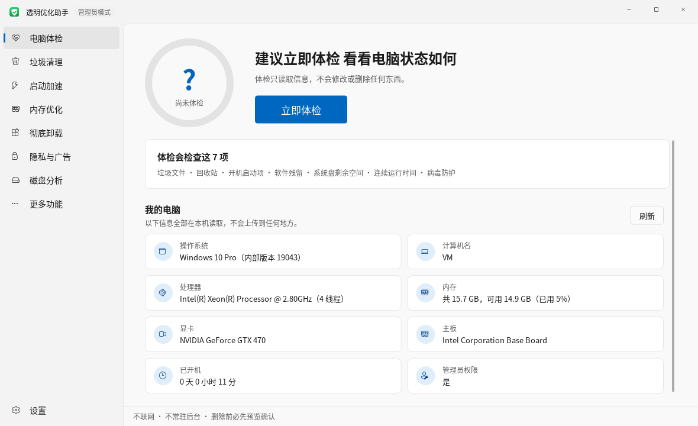
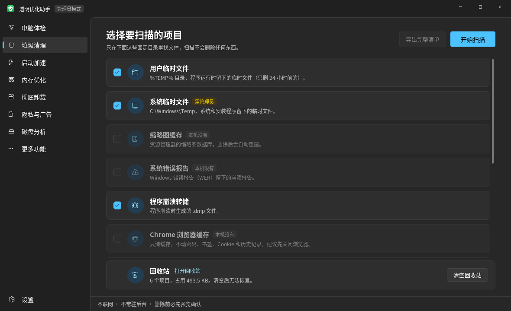

# 透明优化助手

[English](README.md) | **简体中文** | [繁體中文](README.zh-TW.md) | [日本語](README.ja.md)

一个自己看得懂、能审查的 Windows 电脑优化工具：不联网、不常驻、不带广告，所有删除都先列出明细、确认后才执行。

界面支持简体中文、繁体中文、日语和英语，第一次打开时跟随系统语言，之后可以在左下角的“设置”里切换，立即生效。

界面参照 Windows 11 的简约风格，有亮色和暗色两种主题，默认跟随系统设置，也可以在左下角的“设置”里切换；按钮颜色跟随系统的“主题色”。

| 亮色 | 暗色 |
|---|---|
|  |  |

## 直接使用

1. 到 [Releases](../../releases) 下载最新的 zip，解压后双击 `PcOptimizer.exe`。可以用 zip 里的 `SHA256.txt` 核对文件是否完整。
2. 不需要安装任何东西。程序基于 .NET Framework 4.8，Windows 10（1903 及以后）和 Windows 11 都自带。
3. 默认以普通权限运行。清理系统临时文件、更新缓存，以及修改“所有用户”的启动项需要管理员权限，点底栏的“以管理员身份重新打开”即可。

> 第一次运行时，Windows SmartScreen 可能提示“未知发布者”，因为这个 exe 没有数字签名（签名证书要花钱买）。点“更多信息 → 仍要运行”即可。如果不放心，可以按下面的步骤用源码自己编译。

## 功能

| 页面 | 做什么 | 会不会改动电脑 |
|---|---|---|
| 电脑体检 | 检查垃圾文件、回收站、启动项数量、软件残留、系统盘空间、连续运行时间、病毒防护状态和隐私设置，给出评分；下方“我的电脑”显示系统版本、CPU、内存、显卡、主板和开机时长 | 只读。“一键清理垃圾”会先弹窗列出要删的内容 |
| 垃圾清理 | 扫描临时文件、缩略图缓存、错误报告、崩溃转储、Chrome/Edge 缓存、更新缓存和回收站；另有 Windows 更新残留：系统组件旧版本（WinSxS）；“本工具自己的文件”可以查看和清理本工具的操作日志和备份 | 扫描只读；删除前可查看每个文件、导出清单，并且要二次确认；更新残留交给 Windows 自带的 DISM 处理，不用 /ResetBase，已装的更新仍可卸载；日志先预览内容再勾选删除，删掉的进回收站 |
| 启动加速 | 列出注册表 Run 键和启动文件夹里的启动项，用开关禁用或启用；标出“程序已不存在”的失效项 | 正常项只改开关；失效项可以删除，删除前先备份 |
| 内存优化 | 列出你自己运行的软件（同一程序的多个进程合成一项），按占用排序，标出“后台”和“开机自启”；可以结束软件、直接关闭开机自启 | 不列系统进程、杀毒软件和 Windows 目录里的程序；结束时先正常关闭，3 秒不退才强制结束；不做“一键清理内存” |
| 彻底卸载 | 列出已安装的软件，调用软件自带的卸载程序；卸载后查找残留的文件夹、注册表和启动项；标出卸载程序已不存在的失效记录；刚卸载的软件收在顶部一条固定高度的横条里，可单个移走或全部收起 | 卸载由软件自己的卸载程序完成；残留要逐项确认，文件夹进回收站、注册表先备份 |
| 隐私与广告 | 关掉 Windows 自带的广告、推荐和数据收集，共 19 项：开始菜单推荐、锁屏广告、自动安装推荐应用、广告 ID、搜索里的 Bing 结果、Copilot、Recall、可选诊断数据等；“一键关闭推荐项”只关标着“推荐关闭”的 | 改的都是 Windows 自己的设置或组策略对应的注册表值，不停服务、不改 hosts、不动系统文件；每项都能单独恢复默认，也可以“全部恢复默认”；鼠标停在说明上能看到改了哪个值 |
| 更多功能 · 软件更新 | 用 winget 查出有新版本的软件，勾选后一次更新，每个软件右边显示结果和失败原因 | 查找、下载、安装都由 Windows 自带的 winget 完成（它会联网）；静默安装；更新前列出清单确认；结果写进日志 |
| 更多功能 · 预装应用清理 | 列出 Windows 和电脑厂商预装的应用商店应用（游戏、推广应用、用不到的微软应用），分“建议删除”和“看需要”两组，勾选后删除；删除过的应用可以一键打开应用商店装回 | 调用 Windows 自带的 Get-AppxPackage / Remove-AppxPackage，只对当前用户删除；应用商店、安全中心、运行库、图片解码器等系统组件不列出来；删除前列出清单确认 |
| 更多功能 · 病毒防护 | 查看防护状态（实时保护、病毒库日期、第三方杀毒）；快速扫描、全盘扫描、扫描指定文件/文件夹（可拖入）；更新病毒库；看 Defender 的查杀记录 | 不自带病毒库，全部交给 Windows 自带的 Microsoft Defender（MpCmdRun.exe）；发现威胁由 Defender 按默认设置处理（通常隔离），误报可在 Windows 安全中心恢复；更新病毒库时联网的是 Defender，不是本工具 |
| 更多功能 · 文件去重 | 选一个或多个文件夹，找出内容完全相同的文件；每组默认保留最早的那个 | 以 MD5 判断（只对大小相同的文件算 MD5）；每组必须留一个；删除前重新算 MD5，改过的跳过；删掉的进回收站 |
| 更多功能 · 联网控制 | 看哪些软件正在联网、连到哪些地址，也可以持续记录一段时间里所有联过网的软件（管理员身份下用精确模式，一次不漏）；查看哪些端口在监听、能不能被其他电脑连上（标出远程桌面、文件共享、数据库等需要留意的端口）；禁止某个软件联网；限制上传速度 | 禁止联网 = Windows 防火墙规则（名字以“透明优化助手-禁止联网”开头）；上传限速 = Windows 自带 QoS 策略；不装驱动，所以不能限制下载速度 |
| 更多功能 · 右键菜单管理 | 列出软件加进右键菜单的项目，可以隐藏/恢复 | 只隐藏不删除：菜单命令加 LegacyDisable，扩展组件写入 Shell Extensions\Blocked |
| 更多功能 · 文件粉碎 | 把文件或文件夹拖进来，彻底删除，防止被恢复软件找回 | 随机数据覆盖（1 或 3 遍，每遍强制写盘）→ 截成 0 字节 → 随机改名 → 删除；系统/软件目录、AppData、磁盘根目录、用户文件夹本身不允许；粉碎前弹窗确认；SSD 上不能保证物理擦除 |
| 磁盘分析 | 看哪个文件夹、哪个文件最占空间，可逐层点进去；常见的大文件和文件夹（休眠文件、虚拟内存、系统还原点、虚拟机磁盘、下载的安装包等）会说明是什么、能不能删；“硬盘健康”页显示每块硬盘的健康状态、通电时间、温度、磨损程度、读写错误，以及各分区的格式和剩余空间 | 只读；只有标着“一般可以删”的文件才能移到回收站或直接删除（直接删除要二次确认），系统文件不提供删除；健康信息来自 Windows 自带的存储管理接口（Get-PhysicalDisk），部分 USB 硬盘盒和 RAID 读不到 |

## 安全设计

- **不联网**：源码里没有任何网络相关代码，可以搜索 `Http`、`Socket`、`WebClient` 自行确认。“软件更新”和病毒库更新分别交给 Windows 自带的 winget 和 Defender，联网的是它们，不是本工具。
- **不常驻**：不装服务、不加开机启动、不写计划任务，关闭窗口进程就退出。
- **白名单清理**：只在固定目录里找文件，不做全盘“智能识别”。临时文件只删 24 小时前的。
- **删除前复查**：每个文件删除前都会再检查一遍，要求它仍在白名单目录内、扫描后没有变化，而且不是链接。被占用的文件直接跳过。
- **不进入链接**：遇到符号链接或目录联接就跳过，避免顺着链接删到别的地方。
- **可恢复的启动项开关**：用的是 Windows 自己的 `StartupApproved` 机制，和任务管理器“启动”页是同一套开关，在任务管理器里也能改回来。只有指向的程序已经不存在的失效项才允许删除。
- **保守的残留识别**：只认名称完全对得上的位置，包括原安装目录、常见数据目录下与软件名（或“发行商\软件名”）同名的文件夹、注册表 `Software` 下的同名键，以及指向已删除程序的启动项。被其他已安装软件使用的位置、系统目录、用户目录本身、过于通用的名字（如 Update、Common）一律排除。
- **删除可恢复**：残留文件夹移到回收站，无法进回收站时由 Windows 先弹窗询问；注册表在删除前导出成 `.reg` 文件，存在 `logs\backup`，双击即可恢复。
- **操作日志**：每个被删除的文件、每次启动项改动都会写进 `logs\日期.log`。程序目录不可写时，日志改写到 `%LOCALAPPDATA%\PcOptimizer\logs`。
- **隐私开关可恢复**：“隐私与广告”页只改注册表里 Windows 自己的设置值，每次改动都写进日志（含原来的值），“恢复默认”把它们改回 Windows 的默认值。
- 用到的 Windows API 全部集中在 `Core/NativeMethods.cs`，方便审查。

## 自己编译

需要安装 [.NET SDK](https://dotnet.microsoft.com/download)（8.0 或更新）。SDK 只是编译时用，运行 exe 不需要它。

```
双击 build.bat
或者：cd src\PcOptimizer && dotnet build -c Release
```

生成的文件在 `src\PcOptimizer\bin\Release\net48\PcOptimizer.exe`。

运行核心逻辑的测试：

```
cd tests\CoreTests && dotnet run
```

推送到 GitHub 后，`.github/workflows/build.yml` 会在 Windows 上自动跑测试并编译；推送 `v` 开头的标签（例如 `v1.6.0`）会自动创建 Release，附上 zip 和 SHA256。

## 测试情况

- 核心逻辑有 45 个单元测试，覆盖“只删预览中的文件”“不进入链接”“扫描后变化的文件跳过”、卸载残留匹配、`.reg` 备份格式等，另外检查四种语言的翻译表是否一致。运行方法见上面的“自己编译”。
- 作者在自己的 Windows 电脑上日常使用。
- 软件卸载程序、DISM、硬盘健康数据等依赖实际的系统环境，不同电脑上的表现可能不同，遇到问题欢迎提 Issue。

第一次在自己电脑上用时，建议先只扫描，用“查看明细”或“导出完整清单”确认结果没问题，再执行清理。

## 多语言

源码里的界面文字都直接写简体中文，其他语言按“简体原文 → 译文”查表：

- 翻译表在 `src/PcOptimizer/Lang/`（`zh-TW.lang`、`ja.lang`、`en.lang`），编译时嵌入 exe。每条两行：第一行是简体原文，第二行 `=> ` 后面是译文。
- 代码里用 `L.T("原文")`、`L.F("共 {0} 个", n)`；XAML 里的文字由 `UiText.cs` 在控件加载时自动替换，不用改 XAML。
- 查不到译文的文字会显示简体原文。新增或修改界面文字后，记得在三个翻译表里补上对应条目（单元测试会检查三个表的条目是否一致）。
- 语言选择保存在 exe 旁边的 `settings.ini`。

## 免责声明

本工具会删除文件、修改注册表和系统设置。虽然每一步都先预览、再确认，并尽量做成可恢复（回收站、`.reg` 备份），但仍可能因为软件缺陷或误操作造成数据丢失或系统问题。**使用前请自行备份重要数据，使用本工具造成的任何后果由使用者自行承担。** 文件粉碎后的数据无法恢复，请格外小心。

本工具与任何杀毒软件或系统优化软件厂商无关。“病毒防护”只是调用 Windows 自带的 Microsoft Defender。

## 许可证

[MIT](LICENSE)。个人项目，不保证及时回复 Issue。

## 代码结构

```
src/PcOptimizer/
  Core/               业务逻辑（与界面无关）
    Cleaner.cs          清理范围定义、扫描、删除前复查、删除
    MemoryManager.cs    正在运行的软件、结束进程
    Dedup.cs            文件去重（MD5）
    NetControl.cs       连接表、防火墙规则、QoS 限速
    Ports.cs            监听端口的整理和常见端口说明
    NetRecorder.cs      持续记录联过网的软件
    NetTrace.cs         精确模式：用 ETW 接收联网事件
    ContextMenus.cs     右键菜单的读取、隐藏和恢复
    Shredder.cs         文件粉碎
    Defender.cs         病毒防护（调用 Microsoft Defender）
    Privacy.cs          隐私与广告开关
    StoreApps.cs        预装应用（应用商店应用）的读取和删除
    PowerShell.cs       调用 Windows 自带的 PowerShell
    Winget.cs           软件更新（调用 winget 并解析结果）
    WindowsResidue.cs   Windows 更新残留（WinSxS）
    Loc.cs              多语言查表（L.T / L.F）
    AppSettings.cs      设置文件 settings.ini（语言、主题）
    StartupManager.cs   启动项读取与开关
    DiskUsage.cs        磁盘占用统计
    DiskHealth.cs       硬盘健康、使用记录和分区信息
    SpaceHints.cs       常见大文件和文件夹的说明（能不能删）
    LogFiles.cs         本工具日志和备份文件的列出、预览
    SysInfo.cs          系统信息
    HealthCheck.cs      一键体检打分
    Programs.cs         已安装软件列表、卸载命令、失效记录
    Residue.cs          卸载残留查找与清理
    RegBackup.cs        删除注册表前导出 .reg 备份
    ShellLink.cs        读取快捷方式指向的程序
    RecycleBin.cs       回收站
    NativeMethods.cs    全部 Windows API 声明
    FsUtil.cs / OpLog.cs
  Assets/             程序图标 app.ico、标题栏标志 mark.png，以及生成它们的 make-logo.py
  Pages/              各个页面；Pages/Tools/ 是“更多功能”里的工具
  Themes/Styles.xaml  亮/暗两套颜色、按钮、开关、滚动条等样式
  MainWindow.xaml     主窗口（标题栏 + 左侧导航）
  AdminDrop.cs        管理员模式下接收从资源管理器拖进来的文件
  LogWindow.cs        本工具日志的查看和清理窗口
  UiText.cs           把 XAML 里写死的中文换成当前语言
  Theme.cs            亮色/暗色主题和系统主题色
  Lang/               繁体、日语、英语翻译表
tests/CoreTests/      核心逻辑测试
```

## 更新记录

- v2.5.1：“持续记录”的说明和开始/停止按钮固定在顶部，不随列表滚动；记录途中退出程序会先确认。
- v2.5：“持续记录”新增精确模式：以管理员身份运行时通过 Windows 的事件跟踪（ETW，资源监视器用的也是它）接收每一次联网，很短的连接和 DNS 查询这类 UDP 数据也能记到；普通权限下仍是每秒查看一次。
- v2.4：“联网控制”新增“持续记录”：页面开着时每秒查看一次连接表，列出这段时间里所有联过网的软件，偶尔连一下就断开的软件也不容易漏掉。
- v2.3.5：日志很大时（一次大清理可能写出上百 MB），查看日志只读取末尾一部分，不再把整个文件读进内存。
- v2.3.4：“隐私与广告”里，已经在 Windows 自己的设置里隐藏的 Copilot 和任务栏资讯/天气，现在显示为“已隐藏”，不再显示为开启。
- v2.3.3：去掉“系统信息”页，“我的电脑”信息移到“电脑体检”页下方；磁盘情况在“磁盘分析”里看。
- v2.3.2：“磁盘分析”两栏中间加了分隔条，可以左右拖动调整宽度；大文件列表加了右键菜单：移到回收站、直接删除（二次确认）、打开所在文件夹、属性。
- v2.3.1：点“以管理员身份重新打开”后，会回到原来所在的页面；“硬盘健康”的说明改得更简短。
- v2.3：“磁盘分析”新增“硬盘健康”，显示每块硬盘的健康状态、通电时间、温度、磨损和读写错误，以及分区格式和剩余空间；常见的大文件和文件夹会说明是什么、能不能删，可以删的能直接移到回收站。新增本工具日志的查看和清理（先预览内容）。语言菜单里英语排在第一位。修复扫描时切换页面偶尔闪退的问题。
- v2.2.4：左上角标题栏的图标改成和程序图标一样的绿底白盾。
- v2.2.3：去掉删除 Windows.old 的功能。删到一半时如果断电，无法百分之百保证之后“返回旧版本”不出问题；Windows 通常会在退回期限过后自己清理它。
- v2.2.2：删除 Windows.old 的说明和确认里加上“新版本用着没问题、不打算退回时再删”，并说明 Windows 一般只在更新后 10 天内允许退回。
- v2.2.1：把清理系统组件前的提示改得更清楚，不再让人误以为会影响已安装的更新。
- v2.2：“联网控制”新增“监听的端口”，看哪些程序在等别的电脑连进来，并标出需要留意的端口；“垃圾清理”新增“Windows 更新残留”，可以删除 Windows.old 和清理系统组件旧版本（WinSxS）。
- v2.1：新增“软件更新”（在“更多功能”里），用 Windows 自带的 winget 一次更新多个软件。
- v2.0：新增“预装应用清理”（在“更多功能”里，“彻底卸载”页也有入口），删除 Windows 和厂商预装的游戏、推广应用，删除过的可以从应用商店装回。
- v1.9：新增“隐私与广告”页，一键关闭 Windows 自带的广告、推荐和数据收集，随时可以恢复默认；电脑体检增加隐私检查。
- v1.8.1：回收站旁加“打开回收站”链接；搜索框和筛选项之间留出间距；整理标点（标题不用逗号，说明文字以句号结尾）。
- v1.8：切换语言立即生效，不用重新打开；“软件卸载”改名为“彻底卸载”，突出它会在卸载后查找残留。
- v1.7.1：底栏的主题、语言、操作日志、关于收进左下角的“设置”菜单。
- v1.7：界面改成 Windows 11 风格（左侧导航、浅灰配色、跟随系统主题色），支持亮色/暗色主题（默认跟随系统，可手动切换，立即生效）；滚动条、下拉框、菜单和提示框都换成细圆角的新样式。
- v1.6：界面支持繁体中文、日语、英语；补充开源所需的 LICENSE、.gitignore、免责声明和 GitHub 自动编译配置。
- v1.5.1：加上程序图标（绿色圆角底 + 白色盾牌 + 对勾），exe、任务栏和窗口标题栏都会显示。
- v1.5：新增“病毒防护”（接入 Windows 自带的 Microsoft Defender），电脑体检加上病毒防护检查；文件粉碎改为弹窗确认，不用再输入文字。
- v1.4.1：修复“文件粉碎”拖不进文件（鼠标变成🚫）。原因是本工具以管理员身份运行，Windows 不允许普通权限的资源管理器把文件拖给管理员窗口；现在管理员模式下改用 Windows 自带的老式拖放消息接收，并只对这几条消息放行。
- v1.4：新增“文件粉碎”；修复第一次打开“垃圾清理”时卡顿（原因是在界面线程上统计回收站，回收站东西多时要好几秒，现在改到后台）。
- v1.3：新增“更多功能”标签，放文件去重、联网控制、右键菜单管理三个不常用的工具。
- v1.2：新增“内存优化”页。只做真正有用的事：结束不用的常驻软件、关掉它的开机自启。不做“一键清理内存”（清空工作集），那只是把内存挪到硬盘的页面文件里，用的时候再读回来，反而更卡。
- v1.1.1：卸载页“刚卸载的软件”改成固定高度的标签横条，卸载再多也不会挤掉下面的软件列表。
- v1.1：新增软件卸载和残留清理；启动项页标出并可清理“程序已不存在”的项。

## 以后可以加的

计划任务和服务里的自启动项、数字签名。
