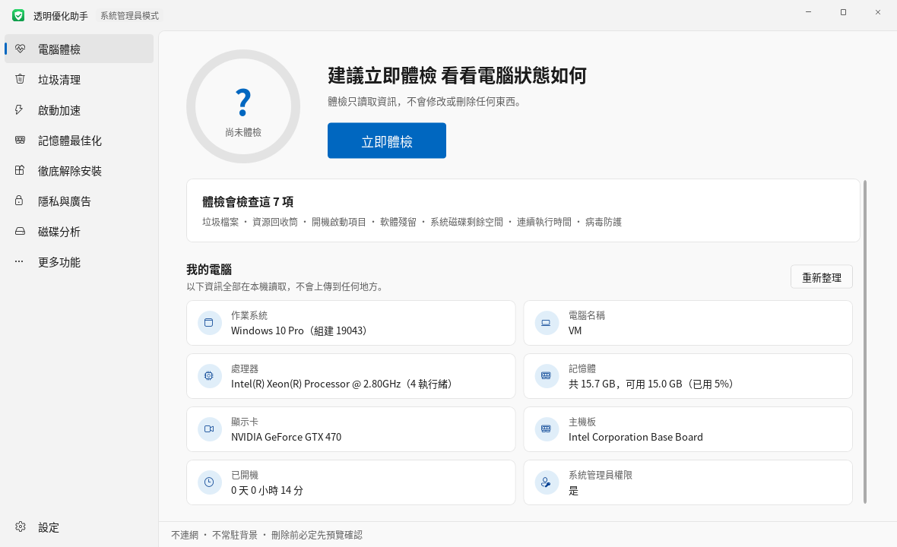
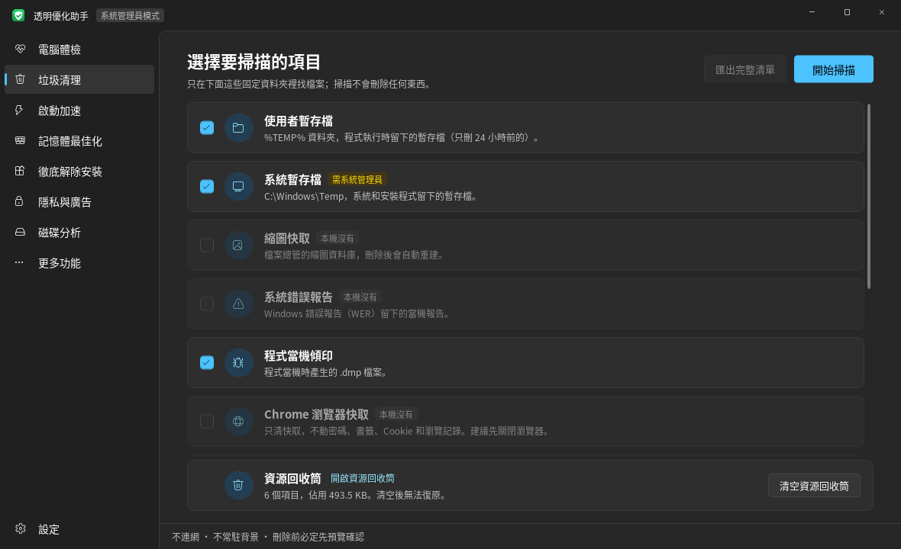

# 透明優化助手

[English](README.md) | [简体中文](README.zh-CN.md) | **繁體中文** | [日本語](README.ja.md)

一個自己看得懂、能審查的 Windows 電腦最佳化工具：不連網、不常駐、不帶廣告，所有刪除都先列出明細、確認後才執行。

介面支援簡體中文、繁體中文、日文和英文，第一次開啟時跟隨系統語言，之後可以在左下角的「設定」裡切換，立即生效。

介面參照 Windows 11 的簡約風格，有淺色和深色兩種主題，預設跟隨系統設定，也可以在左下角的「設定」裡切換；按鈕顏色跟隨系統的「輔色」。

| 淺色 | 深色 |
|---|---|
|  |  |

## 直接使用

1. 到 [Releases](../../releases) 下載最新的 zip，解壓縮後按兩下 `PcOptimizer.exe`。可以用 zip 裡的 `SHA256.txt` 核對檔案是否完整。
2. 不需要安裝任何東西。程式基於 .NET Framework 4.8，Windows 10（1903 及以後）和 Windows 11 都已內建。
3. 預設以一般權限執行。清理系統暫存檔、更新快取，以及修改「所有使用者」的啟動項目需要系統管理員權限，按底列的「以系統管理員身分重新開啟」即可。

> 第一次執行時，Windows SmartScreen 可能提示「未知的發行者」，因為這個 exe 沒有數位簽章（簽章憑證要花錢購買）。按「其他資訊 → 仍要執行」即可。如果不放心，可以按照下面的步驟用原始碼自行編譯。

## 功能

| 頁面 | 做什麼 | 會不會改動電腦 |
|---|---|---|
| 電腦體檢 | 檢查垃圾檔案、資源回收筒、啟動項目數量、軟體殘留、系統磁碟空間、連續執行時間和病毒防護狀態，給出評分；下方「我的電腦」顯示系統版本、CPU、記憶體、顯示卡、主機板和開機時間 | 唯讀。「一鍵清理垃圾」會先跳出視窗列出要刪除的內容 |
| 垃圾清理 | 掃描暫存檔、縮圖快取、錯誤報告、當機傾印、Chrome/Edge 快取、更新快取和資源回收筒；另有 Windows 更新殘留：系統元件舊版本（WinSxS）；「本工具自己的檔案」可以檢視和清理本工具的操作記錄和備份 | 掃描唯讀；刪除前可檢視每個檔案、匯出清單，並且要二次確認；更新殘留交給 Windows 內建的 DISM 處理，不用 /ResetBase，已安裝的更新仍可解除安裝；記錄先預覽內容再勾選刪除，刪掉的進資源回收筒 |
| 啟動加速 | 列出登錄檔 Run 機碼和啟動資料夾裡的啟動項目，用開關停用或啟用；標出「程式已不存在」的失效項目 | 正常項目只改開關；失效項目可以刪除，刪除前先備份 |
| 記憶體最佳化 | 列出你自己執行的軟體（同一程式的多個處理程序合併成一項），依占用排序，標出「背景」和「開機自動啟動」；可以結束軟體、直接關閉開機自動啟動 | 不列出系統處理程序、防毒軟體和 Windows 目錄裡的程式；結束時先正常關閉，3 秒不結束才強制結束；不做「一鍵清理記憶體」 |
| 徹底解除安裝 | 列出已安裝的軟體，呼叫軟體內建的解除安裝程式；解除安裝後尋找殘留的資料夾、登錄檔和啟動項目；標出解除安裝程式已不存在的失效紀錄；剛解除安裝的軟體收在頂部一條固定高度的橫條裡，可個別移除或全部收起 | 解除安裝由軟體自己的解除安裝程式完成；殘留要逐項確認，資料夾移到資源回收筒、登錄檔先備份 |
| 隱私與廣告 | 關掉 Windows 內建的廣告、推薦和資料收集，共 19 項：開始功能表推薦、鎖定畫面廣告、自動安裝推薦應用程式、廣告識別碼、搜尋中的 Bing 結果、Copilot、Recall、選用診斷資料等；「一鍵關閉建議項目」只關標著「建議關閉」的 | 改的都是 Windows 自己的設定或群組原則對應的登錄值，不停用服務、不改 hosts、不動系統檔案；每項都能單獨恢復預設，也可以「全部恢復預設」；滑鼠停在說明上能看到改了哪個值 |
| 更多功能 · 軟體更新 | 用 winget 找出有新版本的軟體，勾選後一次更新，每個軟體右邊顯示結果和失敗原因 | 尋找、下載、安裝都由 Windows 內建的 winget 完成（它會連網）；靜默安裝；更新前列出清單確認；結果寫進日誌 |
| 更多功能 · 預裝應用程式清理 | 列出 Windows 和電腦廠商預裝的 Microsoft Store 應用程式（遊戲、推廣應用程式、用不到的 Microsoft 應用程式），分「建議移除」和「視需要」兩組，勾選後移除；移除過的應用程式可以一鍵開啟 Microsoft Store 裝回 | 呼叫 Windows 內建的 Get-AppxPackage / Remove-AppxPackage，只對目前使用者移除；Microsoft Store、安全性中心、執行階段、圖片解碼器等系統元件不列出來；移除前列出清單確認 |
| 更多功能 · 病毒防護 | 檢視防護狀態（即時保護、病毒碼日期、第三方防毒）；快速掃描、完整掃描、掃描指定檔案/資料夾（可拖曳進來）；更新病毒碼；檢視 Defender 的掃毒紀錄 | 不內建病毒碼，全部交給 Windows 內建的 Microsoft Defender（MpCmdRun.exe）；發現威脅由 Defender 依預設設定處理（通常為隔離），誤判可在 Windows 安全性中還原；更新病毒碼時連網的是 Defender，不是本工具 |
| 更多功能 · 檔案去重 | 選擇一個或多個資料夾，找出內容完全相同的檔案；每組預設保留最早的那個 | 以 MD5 判斷（只對大小相同的檔案計算 MD5）；每組必須保留一個；刪除前重新計算 MD5，有變更的略過；刪除的檔案移到資源回收筒 |
| 更多功能 · 連網控制 | 檢視哪些軟體正在連網、連到哪些位址，也可以持續記錄一段時間裡所有連過網的軟體（系統管理員身分下用精確模式，一次不漏）；檢視哪些連接埠在監聽、能不能被其他電腦連上（標出遠端桌面、檔案共用、資料庫等需要留意的連接埠）；禁止某個軟體連網；限制上傳速度 | 禁止連網 = Windows 防火牆規則（名稱以「透明优化助手-禁止联网」開頭）；上傳限速 = Windows 內建 QoS 原則；不安裝驅動程式，所以無法限制下載速度 |
| 更多功能 · 右鍵選單管理 | 列出軟體加進右鍵選單的項目，可以隱藏/還原 | 只隱藏不刪除：選單命令加上 LegacyDisable，擴充元件寫入 Shell Extensions\Blocked |
| 更多功能 · 檔案粉碎 | 把檔案或資料夾拖曳進來，徹底刪除，防止被救援軟體找回 | 以隨機資料覆寫（1 或 3 遍，每遍強制寫入磁碟）→ 截成 0 位元組 → 隨機重新命名 → 刪除；系統/軟體目錄、AppData、磁碟根目錄、使用者資料夾本身不允許；粉碎前跳出視窗確認；在 SSD 上無法保證實體抹除 |
| 磁碟分析 | 檢視哪個資料夾、哪個檔案最占空間，可逐層點進去；常見的大檔案和資料夾（休眠檔、虛擬記憶體、系統還原點、虛擬機器磁碟、下載的安裝檔等）會說明是什麼、能不能刪；「硬碟健康」頁顯示每顆硬碟的健康狀態、通電時間、溫度、磨損程度、讀寫錯誤，以及各分割區的格式和剩餘空間 | 唯讀；只有標著「一般可以刪」的檔案才能移到資源回收筒或直接刪除（直接刪除要二次確認），系統檔案不提供刪除；健康資訊來自 Windows 內建的存放管理介面（Get-PhysicalDisk），部分 USB 硬碟外接盒和 RAID 讀不到 |

## 安全設計

- **不連網**：原始碼裡沒有任何網路相關程式碼，可以搜尋 `Http`、`Socket`、`WebClient` 自行確認。「軟體更新」和病毒碼更新分別交給 Windows 內建的 winget 和 Defender，連網的是它們，不是本工具。
- **不常駐**：不安裝服務、不加入開機啟動、不寫入排程工作，關閉視窗處理程序就結束。
- **白名單清理**：只在固定目錄裡找檔案，不做全磁碟「智慧辨識」。暫存檔只刪除 24 小時前的。
- **刪除前複查**：每個檔案刪除前都會再檢查一遍，要求它仍在白名單目錄內、掃描後沒有變化，而且不是連結。被占用的檔案直接略過。
- **不進入連結**：遇到符號連結或目錄連接就略過，避免順著連結刪到別的地方。
- **可還原的啟動項目開關**：用的是 Windows 自己的 `StartupApproved` 機制，和工作管理員「啟動」頁是同一套開關，在工作管理員裡也能改回來。只有指向的程式已經不存在的失效項目才允許刪除。
- **保守的殘留辨識**：只認名稱完全對得上的位置，包括原安裝目錄、常見資料目錄下與軟體名稱（或「發行者\軟體名稱」）同名的資料夾、登錄檔 `Software` 下的同名機碼，以及指向已刪除程式的啟動項目。被其他已安裝軟體使用的位置、系統目錄、使用者目錄本身、過於通用的名稱（如 Update、Common）一律排除。
- **刪除可還原**：殘留資料夾移到資源回收筒，無法移到資源回收筒時由 Windows 先跳出視窗詢問；登錄檔在刪除前匯出成 `.reg` 檔案，存放在 `logs\backup`，按兩下即可還原。
- **操作日誌**：每個被刪除的檔案、每次啟動項目變更都會寫進 `logs\日期.log`。程式目錄無法寫入時，日誌改寫到 `%LOCALAPPDATA%\PcOptimizer\logs`。
- 用到的 Windows API 全部集中在 `Core/NativeMethods.cs`，方便審查。

## 自行編譯

需要安裝 [.NET SDK](https://dotnet.microsoft.com/download)（8.0 或更新版本）。SDK 只在編譯時使用，執行 exe 不需要它。

```
按兩下 build.bat
或者：cd src\PcOptimizer && dotnet build -c Release
```

產生的檔案在 `src\PcOptimizer\bin\Release\net48\PcOptimizer.exe`。

執行核心邏輯的測試：

```
cd tests\CoreTests && dotnet run
```

推送到 GitHub 後，`.github/workflows/build.yml` 會在 Windows 上自動執行測試並編譯；推送以 `v` 開頭的標籤（例如 `v1.6.0`）會自動建立 Release，附上 zip 和 SHA256。

## 測試情況

- 核心邏輯有 45 個單元測試，涵蓋「只刪除預覽中的檔案」「不進入連結」「掃描後有變化的檔案略過」、解除安裝殘留比對、`.reg` 備份格式等，另外檢查四種語言的翻譯表是否一致。執行方式見上面的「自行編譯」。
- 作者在自己的 Windows 電腦上日常使用。
- 軟體解除安裝程式、DISM、硬碟健康資料等依賴實際的系統環境，不同電腦上的表現可能不同，遇到問題歡迎提 Issue。

第一次在自己的電腦上使用時，建議先只掃描，用「查看明細」或「匯出完整清單」確認結果沒問題，再執行清理。

## 多語言

原始碼裡的介面文字都直接寫成簡體中文，其他語言依「簡體原文 → 譯文」查表：

- 翻譯表在 `src/PcOptimizer/Lang/`（`zh-TW.lang`、`ja.lang`、`en.lang`），編譯時嵌入 exe。每筆兩行：第一行是簡體原文，第二行 `=> ` 後面是譯文。
- 程式碼裡用 `L.T("...")`、`L.F("... {0} ...", n)`（引號裡寫簡體中文原文）；XAML 裡的文字由 `UiText.cs` 在控制項載入時自動替換，不用修改 XAML。
- 查不到譯文的文字會顯示簡體原文。新增或修改介面文字後，記得在三個翻譯表裡補上對應項目（單元測試會檢查三個表的項目是否一致）。
- 語言選擇儲存在 exe 旁邊的 `settings.ini`。

## 免責聲明

本工具會刪除檔案、修改登錄檔和系統設定。雖然每一步都先預覽、再確認，並盡量做成可還原（資源回收筒、`.reg` 備份），但仍可能因為軟體缺陷或操作失誤造成資料遺失或系統問題。**使用前請自行備份重要資料，使用本工具造成的任何後果由使用者自行承擔。** 檔案粉碎後的資料無法復原，請格外小心。

本工具與任何防毒軟體或系統最佳化軟體廠商無關。「病毒防護」只是呼叫 Windows 內建的 Microsoft Defender。

## 授權條款

[MIT](LICENSE)。個人專案，不保證即時回覆 Issue。

## 程式碼結構

```
src/PcOptimizer/
  Core/               業務邏輯（與介面無關）
    Cleaner.cs          清理範圍定義、掃描、刪除前複查、刪除
    MemoryManager.cs    正在執行的軟體、結束處理程序
    Dedup.cs            檔案去重（MD5）
    NetControl.cs       連線表、防火牆規則、QoS 限速
    Ports.cs            監聽連接埠的整理和常見連接埠說明
    NetRecorder.cs      持續記錄連過網的軟體
    NetTrace.cs         精確模式：用 ETW 接收連網事件
    ContextMenus.cs     右鍵選單的讀取、隱藏和還原
    Shredder.cs         檔案粉碎
    Defender.cs         病毒防護（呼叫 Microsoft Defender）
    Privacy.cs          隱私與廣告開關
    StoreApps.cs        預裝應用（市集應用）的讀取和刪除
    PowerShell.cs       呼叫 Windows 內建的 PowerShell
    Winget.cs           軟體更新（呼叫 winget 並解析結果）
    WindowsResidue.cs   Windows 更新殘留（WinSxS）
    Loc.cs              多語言查表（L.T / L.F）
    AppSettings.cs      設定檔 settings.ini（語言、主題）
    StartupManager.cs   啟動項目讀取與開關
    DiskUsage.cs        磁碟占用統計
    DiskHealth.cs       硬碟健康、使用記錄和分割區資訊
    SpaceHints.cs       常見大檔案和資料夾的說明（能不能刪）
    LogFiles.cs         本工具記錄和備份檔案的列出、預覽
    SysInfo.cs          系統資訊
    HealthCheck.cs      一鍵健檢評分
    Programs.cs         已安裝軟體清單、解除安裝命令、失效記錄
    Residue.cs          解除安裝殘留的尋找與清理
    RegBackup.cs        刪除登錄檔前匯出 .reg 備份
    ShellLink.cs        讀取捷徑指向的程式
    RecycleBin.cs       資源回收筒
    NativeMethods.cs    全部 Windows API 宣告
    FsUtil.cs / OpLog.cs
  Assets/             程式圖示 app.ico、標題列標誌 mark.png，以及產生它們的 make-logo.py
  Pages/              各個頁面；Pages/Tools/ 是「更多功能」裡的工具
  Themes/Styles.xaml  淺色/深色兩套顏色、按鈕、開關、捲軸等樣式
  MainWindow.xaml     主視窗（標題列 + 左側導覽）
  AdminDrop.cs        系統管理員模式下接收從檔案總管拖進來的檔案
  LogWindow.cs        本工具記錄的檢視和清理視窗
  UiText.cs           把 XAML 裡寫死的中文換成目前語言
  Theme.cs            淺色/深色主題和系統輔色
  Lang/               繁體、日文、英文翻譯表
tests/CoreTests/      核心邏輯測試
```

## 更新紀錄

- v2.5.1：「持續記錄」的說明和開始/停止按鈕固定在頂部，不隨清單捲動；記錄途中結束程式會先確認。
- v2.5：「持續記錄」新增精確模式：以系統管理員身分執行時透過 Windows 的事件追蹤（ETW，資源監視器用的也是它）接收每一次連網，很短的連線和 DNS 查詢這類 UDP 資料也能記到；一般權限下仍是每秒查看一次。
- v2.4：「連網控制」新增「持續記錄」：頁面開著時每秒查看一次連線表，列出這段時間裡所有連過網的軟體，偶爾連一下就中斷的軟體也不容易漏掉。
- v2.3.5：記錄很大時（一次大清理可能寫出上百 MB），檢視記錄只讀取末尾一部分，不再把整個檔案讀進記憶體。
- v2.3.4：「隱私與廣告」裡，已經在 Windows 自己的設定裡隱藏的 Copilot 和工作列資訊/天氣，現在顯示為「已隱藏」，不再顯示為開啟。
- v2.3.3：移除「系統資訊」頁，「我的電腦」資訊移到「電腦體檢」頁下方；磁碟情況在「磁碟分析」裡看。
- v2.3.2：「磁碟分析」兩欄中間加了分隔條，可以左右拖曳調整寬度；大檔案清單加了右鍵選單：移到資源回收筒、直接刪除（二次確認）、開啟所在資料夾、內容。
- v2.3.1：點「以系統管理員身分重新開啟」後，會回到原來所在的頁面；「硬碟健康」的說明改得更簡短。
- v2.3：「磁碟分析」新增「硬碟健康」，顯示每顆硬碟的健康狀態、通電時間、溫度、磨損和讀寫錯誤，以及分割區格式和剩餘空間；常見的大檔案和資料夾會說明是什麼、能不能刪，可以刪的能直接移到資源回收筒。新增本工具記錄的檢視和清理（先預覽內容）。語言選單裡英語排在第一位。修正掃描時切換頁面偶爾閃退的問題。
- v2.2.4：左上角標題列的圖示改成和程式圖示一樣的綠底白盾。
- v2.2.3：移除刪除 Windows.old 的功能。刪到一半時如果斷電，無法百分之百保證之後「返回舊版本」不出問題；Windows 通常會在退回期限過後自己清理它。
- v2.2.2：刪除 Windows.old 的說明和確認裡加上「新版本用起來沒問題、不打算退回時再刪」，並說明 Windows 一般只在更新後 10 天內允許退回。
- v2.2.1：把清理系統元件前的提示改得更清楚，不再讓人誤以為會影響已安裝的更新。
- v2.2：「連網控制」新增「監聽的連接埠」，檢視哪些程式在等別的電腦連進來，並標出需要留意的連接埠；「垃圾清理」新增「Windows 更新殘留」，可以刪除 Windows.old 和清理系統元件舊版本（WinSxS）。
- v2.1：新增「軟體更新」（在「更多功能」裡），用 Windows 內建的 winget 一次更新多個軟體。
- v2.0：新增「預裝應用程式清理」（在「更多功能」裡，「徹底解除安裝」頁也有入口），移除 Windows 和廠商預裝的遊戲、推廣應用程式，移除過的可以從 Microsoft Store 裝回。
- v1.9：新增「隱私與廣告」頁，一鍵關閉 Windows 內建的廣告、推薦和資料收集，隨時可以恢復預設；電腦健檢增加隱私檢查。
- v1.8.1：資源回收筒旁加上「開啟資源回收筒」連結；搜尋框和篩選項之間留出間距；整理標點（標題不用逗號，說明文字以句號結尾）。
- v1.8：切換語言立即生效，不用重新開啟；「軟體解除安裝」改名為「徹底解除安裝」，強調它會在解除安裝後尋找殘留。
- v1.7.1：底列的主題、語言、操作紀錄、關於收進左下角的「設定」選單。
- v1.7：介面改為 Windows 11 風格（左側導覽、淺灰配色、跟隨系統輔色），支援淺色/深色主題（預設跟隨系統，可手動切換，立即生效）；捲軸、下拉選單、選單和提示框都換成細圓角的新樣式。
- v1.6：介面支援繁體中文、日文、英文；補上開源所需的 LICENSE、.gitignore、免責聲明和 GitHub 自動編譯設定。
- v1.5.1：加上程式圖示（綠色圓角底 + 白色盾牌 + 勾號），exe、工作列和視窗標題列都會顯示。
- v1.5：新增「病毒防護」（接入 Windows 內建的 Microsoft Defender），電腦體檢加上病毒防護檢查；檔案粉碎改為跳出視窗確認，不用再輸入文字。
- v1.4.1：修正「檔案粉碎」無法拖曳檔案進來（滑鼠游標變成🚫）。原因是本工具以系統管理員身分執行，Windows 不允許一般權限的檔案總管把檔案拖曳給系統管理員視窗；現在系統管理員模式下改用 Windows 內建的舊式拖放訊息接收，並只對這幾個訊息放行。
- v1.4：新增「檔案粉碎」；修正第一次開啟「垃圾清理」時卡頓（原因是在介面執行緒上統計資源回收筒，資源回收筒東西多時要好幾秒，現在改到背景執行）。
- v1.3：新增「更多功能」分頁，放置檔案去重、連網控制、右鍵選單管理三個不常用的工具。
- v1.2：新增「記憶體最佳化」頁。只做真正有用的事：結束不用的常駐軟體、關掉它的開機自動啟動。不做「一鍵清理記憶體」（清空工作集），那只是把記憶體搬到硬碟的分頁檔裡，用的時候再讀回來，反而更卡。
- v1.1.1：解除安裝頁的「剛解除安裝的軟體」改成固定高度的標籤橫條，解除安裝再多也不會擠掉下面的軟體清單。
- v1.1：新增軟體解除安裝和殘留清理；啟動項目頁標出並可清理「程式已不存在」的項目。

## 之後可以加入的

排程工作和服務裡的自動啟動項目、數位簽章。
